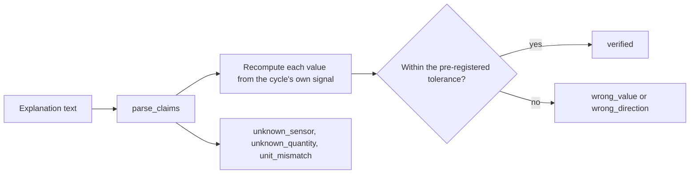
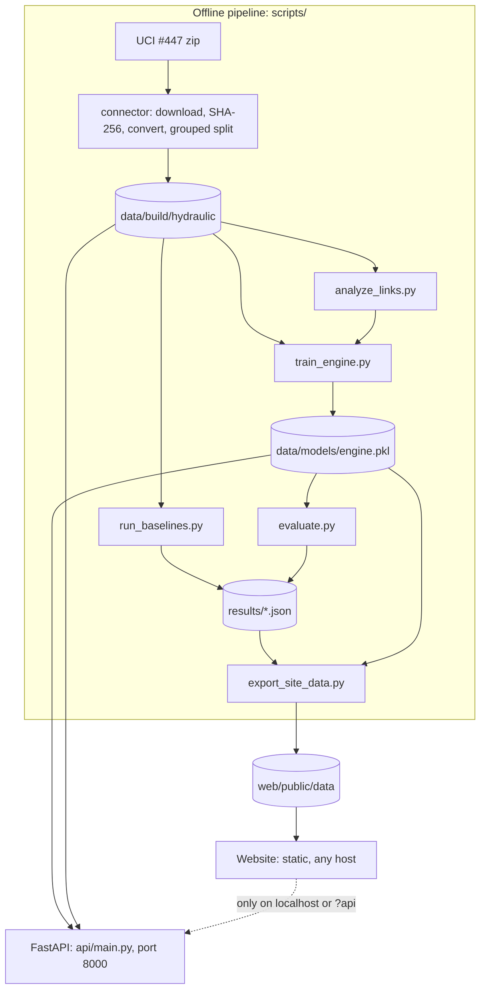
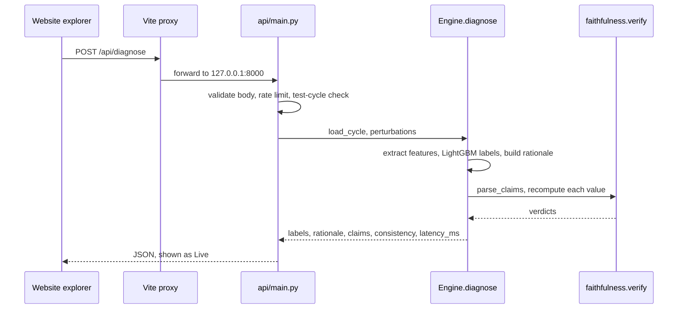
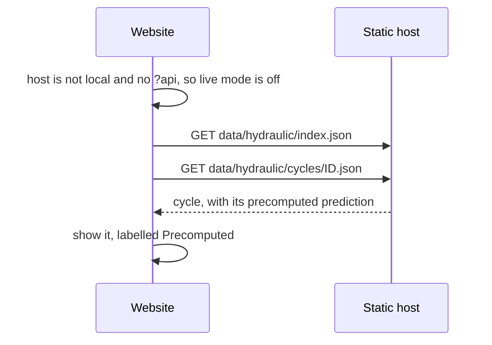

# Architecture

> How Sightglass turns one 60-second cycle of sensor data into a diagnosis whose every number has been checked. The reference pages hold the details: [model](docs/model.md), [API](docs/api.md), [website](docs/ui.md), [environment](docs/environment.md), [deployment](docs/deployment.md). Results are in the [README](README.md#results), and nowhere else.

## 1. Core ideas

**The checker does not trust the explainer.** The rationale engine computes its numbers from the signal and writes them as text. The checker then reads that text back like any model's output, with no access to the engine's internals, and recomputes each number from the same cycle. A future language model will be held to exactly the same parser and tolerances, which is the point of building the checker first.

**Evidence is limited to links the data supports.** An explanation may only cite a feature that was measured, on the train split, to move with that component in the expected physical direction. Textbook links that did not hold on this rig were dropped, so the accumulator has only one.

**Nothing on the page is typed.** Every figure flows from a script's output file to the export to the page, and a CI check fails if a number appears in `web/src`.

## 2. Topology

There is one offline pipeline that writes files, and two optional readers of those files. No database, no queue, no service that has to be running for the site to work.

The split exists so the site can be static. A judge on GitHub Pages gets the whole page with no server, and the API is there for someone who wants to see the engine work live on their machine. The cost is that the site shows only the 329 test cycles that were exported, and a change to the engine means re-exporting about 18 MB of JSON.

## 3. Components

### 3.1 Connector: `connector/timenet_connectors/datasets/uci/uci_hydraulic/connector.py`

Owns getting the data right. It downloads the UCI archive once, refuses it if the SHA-256 differs, reads the 17 sensor files at their native rates (100, 10 and 1 Hz), checks every shape and label value, and writes one `.npy` file per sensor plus `labels.npy`, `splits.json` and `manifest.json`. It also makes both splits: the grouped one used for every result, and a random one kept only for the leakage ablation.

It does not yet follow TimeNet's connector interface: it writes its own build rather than a TimeF dataset. The draft pull request text in `docs/pr/hydraulic.md` says so.

### 3.2 Physics: `src/sightglass/physics/hydraulic.py`, `base.py`

Owns the 43 features and the healthy reference. Every feature records its sensor, unit and time window, so a claim can be traced to a stretch of signal. `HealthyReference.fit_per_component` is the one place the reference is fitted, from train cycles only. The bearing and wind modules beside it run only on synthetic signals.

### 3.3 Rationale engine: `src/sightglass/rationales/`

Owns the wording. `format.py` holds the clause grammar, `builder.py` picks up to three linked features per component and phrases them, and `templates.py` adds a sentence of interpretation chosen by a stable seed. It never decides a label: it explains the label it is given.

### 3.4 Checker: `src/sightglass/eval/faithfulness.py`, `consistency.py`

Owns the verdicts. `parse_claims` finds each clause, `verify` recomputes the value with the same extractor and compares it under `configs/faithfulness.yaml`. `ConsistencyChecker` asks a separate question: does the recomputed evidence point to the stated label? A paragraph can be fully verified and still inconsistent.

### 3.5 Engine: `src/sightglass/engine.py`

Joins the parts for one cycle: perturb (optional), extract, predict with LightGBM, explain, parse, verify, check consistency. The API, the export and the evaluation all call `Engine.diagnose`, so they cannot disagree.

### 3.6 API: `api/main.py`

Loads the engine and the build once, then answers three routes. It validates input strictly, serves only test cycles and rate-limits per client. See [docs/api.md](docs/api.md).

### 3.7 Website: `web/`

Reads the export, and calls the API only where it can exist. See [docs/ui.md](docs/ui.md).

### 3.8 TSLM: `src/sightglass/tslm/`

The prompt builder, model wrapper and training loop for OpenTSLM-Flamingo. The CPU smoke mode runs; the full mode raises `NotImplementedError` until OpenTSLM's trainer is wired in. Nothing else depends on it.

## 4. Execution flows

### 4.1 A live diagnosis

What to notice: the API never returns a stored answer. Each request reruns the whole chain, which is why it takes tens of milliseconds rather than one.

### 4.2 The same page with no API

What to notice: the fallback is decided once, up front, and the result is labelled either way.

### 4.3 A live call that fails

On a local host with no API running, the proxy answers 502. The page marks the API offline, stops trying for the rest of the visit, and shows the precomputed result for the same cycle. The visitor sees a result and a note saying how to start the engine, never an error in place of one.

### 4.4 The checker being tested

`scripts/build_rationales.py` writes a reference rationale for every one of the 2,205 cycles, checks that every claim verifies, then makes 1,000 copies with one stated value moved by 20% and others with one "above" swapped for "below", and counts how many no longer verify. The result is `results/checker_validation.json`. This is the evidence that a "verified" verdict means something.

## 5. State and persistence

All state is files. Nothing is written at request time.

| Where | What | Made by | Tracked in git |
|---|---|---|---|
| `data/raw/hydraulic/` | The UCI zip and its text files | `make data` | no |
| `data/build/hydraulic/` | One `.npy` per sensor, `labels.npy`, `splits.json`, `manifest.json` | `make data` | no |
| `data/reference/`, `data/rationales/`, `data/qa/` | Healthy reference, reference rationales, question and answer pairs | `make rationales` | no |
| `data/models/engine.pkl` | The trained engine (pickle) | `make engine` | no |
| `configs/physics/hydraulic_links.yaml` | Measured links | `make links` | yes |
| `results/` | Every result, and one folder per run with its config, environment and predictions | `make baselines`, `make eval` | yes |
| `web/public/data/` | The export the site reads | `make export` | yes |

The API's rate-limit counters are the only state in memory, and they are lost on restart.

## 6. Security and observability

The API is read-only, accepts only test-cycle ids and bounded perturbations, refuses unknown fields, and rate-limits per client address in memory. It has no authentication, and it loads a pickle, so it should only ever load an engine you trained. The full threat model is in [docs/security.md](docs/security.md).

To see what it is doing: `GET /api/health` reports whether the engine loaded and, if not, why. Each diagnosis carries `latency_ms`. Every pipeline run writes a folder under `results/runs/` with its config, its environment and its predictions.

## 7. Where each part is proved

| Part | Command | What it covers |
|---|---|---|
| Connector | `make test` | Sensor rates and lengths, label sets, disjoint grouped splits with every class in train, deterministic conversion, rejection of bad shapes |
| Physics | `make test` | Feature names, values on synthetic signals with known answers, reference fitted on healthy train cycles only |
| Checker | `make test`, `make rationales` | Parser for both clause forms, round trip, corruption, unknown sensors and quantities, the consistency rule; then the full-dataset validation |
| Engine and API | `make test` with the build present | A real cycle whose claims all verify, a perturbation, refusals |
| Website | `npm test` in `web/` | The rationale splitter, claim chips, default-cycle choice |
| No typed numbers | `python scripts/check_no_hardcoded_numbers.py` | Every visible number in `web/src` |
