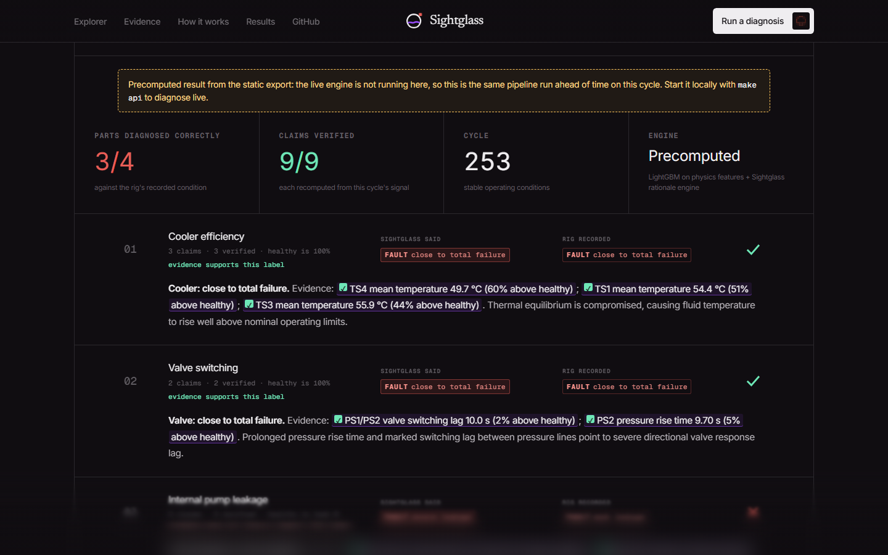
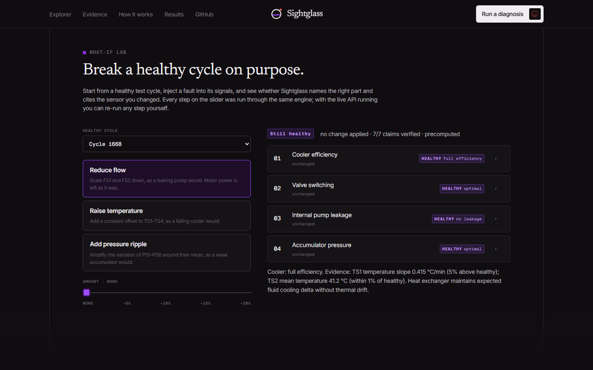
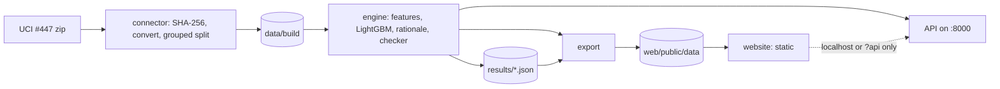

# Sightglass

**Fault diagnosis for a hydraulic test rig, where every number in the explanation is recomputed from the sensor signal and marked verified or not.**
*Show the evidence, then check it.*

A hydraulic press has four parts that wear out quietly: the cooler, the valve, the pump and the accumulator. A condition-monitoring alarm says the machine is off. It does not say which part, and so someone pulls up seventeen sensor traces and starts comparing them with a healthy cycle from memory. Ask a language model to explain the traces and you get a fluent paragraph with flow rates and temperatures in it, and no way to know whether any of those numbers are in the data.

Sightglass reads one 60-second cycle of the UCI #447 test rig's 17 sensors, names the condition of each of the four parts, and gives the evidence for each as clauses like `FS1 mean volume flow 5.70 l/min (13% below healthy)`. Then **a separate checker parses that text back, recomputes every stated number from the cycle's own signal, and marks each claim verified or wrong** under tolerances fixed before any test result existed. The checker is itself tested: it catches every value corruption and flipped direction planted in 2,205 reference explanations.

It is not a language model yet. The diagnosis is LightGBM on 43 physics features, and the explanation is written by rules from the same features, so its claims verify by construction. The OpenTSLM language model that the checker was built for has its code and configs, and has not been trained. Nothing here has seen a real plant.

**Start here:** [See it in a minute](#the-fastest-way-to-see-it) · [Results](#results) · [What is verified](#what-is-verified-and-what-is-not) · [Run it](#run-it) · [How it works](ARCHITECTURE.md) · [Evaluate it](TESTING.md) · [All the docs](docs/README.md)

---

## The fastest way to see it

**On the web,** once GitHub Pages is enabled for this repository: https://devprashant19.github.io/Sightglass/. It is the static site, with every result precomputed by the same engine.

**On your machine,** with Node 22:

```bash
git clone https://github.com/devprashant19/Sightglass.git
cd Sightglass
make web            # npm install, then the site on http://localhost:5173
```

Then open **http://localhost:5173/?cycle=hydraulic-00253&run**. It runs one test cycle and scrolls to the verdict. On that cycle the pump is called *severe* leakage where the rig recorded *weak*, and all nine numbers in the explanation still verify: a verified number is not a correct diagnosis, and the page shows both. Add `&ask` instead of `&run` to open the console on a cycle. [TESTING.md](TESTING.md) has the five-minute tour.

---

## What it looks like

Captured from the production build with no API running, by `node docs/screenshots/capture.mjs` (see [docs/ui.md](docs/ui.md#screens)).

| | |
|---|---|
|  |  |
| **A diagnosis.** Each part's verdict beside the one the rig recorded, and each number in the evidence ticked after it was recomputed from the signal. | **The what-if lab.** Perturb a healthy cycle and watch which verdict moves. It shows the shortcuts the model learned, too. |

---

## Results

<!-- results:start -->
Real UCI #447 test split (329 cycles, grouped by condition). Generated by `scripts/make_readme_table.py`.

| Model | Mean macro-F1 | Cooler | Valve | Pump | Accumulator | Joint exact match | Claims verified |
|---|---|---|---|---|---|---|---|
| Majority class | 0.149 | 0.184 | 0.141 | 0.170 | 0.101 | 0.064 | — |
| Physics features + LightGBM | 0.959 ± 0.000 | 1.000 | 0.997 | 0.969 | 0.870 | 0.842 | — |
| MiniRocket + ridge | 0.967 ± 0.002 | 1.000 | 1.000 | 0.993 | 0.875 | 0.869 | — |
| 1D-CNN | 0.841 ± 0.022 | 1.000 | 0.969 | 0.929 | 0.466 | 0.430 | — |
| Tokenized-text LLM | not run | | | | | | needs GPU LLM fine-tune (LoRA on the TSLM backbone); not run. |
| GPT-4o on plots | not run | | | | | | OPENAI_API_KEY is not set, so the GPT-4o baseline was not run. |
| **Sightglass engine** (B1 + rationale engine) | **0.959** | 1.000 | 0.997 | 0.969 | 0.870 | 0.842 | 2721/2721 (by construction) |
| Sightglass TSLM (OpenTSLM-Flamingo) | pending | | | | | | OpenTSLM-Flamingo fine-tuning needs a GPU with about 20 GB for Llama-3.2 1B; it has not been run. Its outputs will go through the same checker. |

Checker validation: round trip 100.0% of 17883 claims; ±20% value corruptions caught 100.0% (n=1000); direction flips caught 100.0% (n=529). Label–evidence consistency of the engine: 63.7%.
- B1 without virtual sensors (CE, CP, SE): mean macro-F1 0.961 (+0.002 vs B1).
- B1 on a random split instead of the grouped split: mean macro-F1 0.998 (+0.039 vs B1).
<!-- results:end -->

How to read it:

- **The test cycles come from operating conditions never seen in training.** The split is by the combination of the four labels, so a random split, where neighbouring near-identical cycles land on both sides, scores higher (the last line).
- **The engine is B1.** Its labels come from the same LightGBM, so its accuracy is B1's. MiniRocket on the raw signals scores slightly higher, and explains nothing.
- **The engine's 100% verified claims are expected, not an achievement.** Its numbers are computed from the signal. What the 100% shows is that the explainer and the checker agree. Whether the checker can be trusted is the corruption line, and how good the evidence is, is the consistency figure: how often the recomputed evidence actually points to the stated label. It is the weak spot, lowest for the pump and the accumulator.
- **The comparison this project exists for is missing.** No language model's explanations have been through the checker yet: the two LLM baselines and the TSLM were not run.

Confidence intervals, confusion matrices and failures are in `results/eval_engine.json` and `results/failures.json`. What they mean: [docs/model.md](docs/model.md).

---

## Run it

> Evaluating this rather than changing it? [TESTING.md](TESTING.md) is written for you, with four levels from a minute to the whole pipeline.

Needs **Python 3.12** with [uv](https://docs.astral.sh/uv/), and **Node 22** for the site. No GPU, no API key. About 1 GB of disk for the data and 1.3 GB for the Python environment.

```bash
git clone https://github.com/devprashant19/Sightglass.git
cd Sightglass
uv venv --python 3.12
uv pip sync requirements-lock.txt   # the exact versions behind the results
uv pip install --no-deps -e .
make data                          # download UCI #447 (about 77 MB), check its SHA-256, build data/build/hydraulic
python scripts/train_engine.py     # data/models/engine.pkl
make api                           # live engine on 127.0.0.1:8000
make web                           # second terminal: the site on http://localhost:5173
```

The site's status line then says **Live engine ready**, and each diagnosis is computed on request. Without `make api` the site still works, from the precomputed export, and says so on every result. Without `make data`, the API reports what is missing at `/api/health`, and the tests that need it skip.

| Command | What it does |
|---|---|
| `make web` | The site on port 5173, proxying `/api` to port 8000 |
| `make api` | The live API: `/api/health`, `/api/cycles/{id}`, `/api/diagnose` ([docs/api.md](docs/api.md)) |
| `make test` | Python tests. The API tests skip without the build |
| `make lint` | ruff and mypy |
| `make all` | The whole pipeline, from download to README table, then lint and tests |

### Prove it rather than read about it

```bash
make test                                       # connector, physics, checker, consistency, number gate, API
cd web && npm test && cd ..                     # rationale splitting, claim chips, default cycle
python scripts/check_no_hardcoded_numbers.py    # no result number typed into the site
```

Run `make test` first. With the build and the engine present, on Windows 11:

```text
.......................................                                  [100%]
39 passed, 1 warning in 22.56s
```

The warning is a deprecation notice from Starlette's test client.

---

## Every number is checked against the signal

This is the part that makes Sightglass different from a classifier with a paragraph attached. It runs in the same order for every cycle, in `Engine.diagnose` (`src/sightglass/engine.py`), whether called by the API, the export or the evaluation.

1. **Features at native rates.** `src/sightglass/physics/hydraulic.py` computes 43 features from the cycle: pressure means, peaks, ripple and rise times at 100 Hz, the delay from PS1 to PS2 that shows a lagging valve, flow at 10 Hz, power per litre of flow, temperatures and their slopes at 1 Hz. Each records its sensor, unit and time window. Nothing is resampled to a common rate, so a stated value can be traced to a stretch of one signal.
2. **Labels.** One LightGBM classifier per part predicts its condition from those features.
3. **A healthy reference, fitted per part.** Each feature needs a "healthy" value to compare against. Only 21 cycles in the whole dataset have all four parts healthy, and the grouped split put all of them in test. So the reference for a feature linked to the pump comes from train cycles where the *pump* is healthy, whatever the other parts are doing (`HealthyReference.fit_per_component`). Train only, always.
4. **Only links the data supports.** An explanation may cite a feature for a part only if `scripts/analyze_links.py` measured, on train, that the feature moves with that part in the physically expected direction, and the effect survived holding the other parts fixed. Some textbook links failed on this rig and were dropped, such as the temperature drop across the cooler. The accumulator kept one link, PS2 ripple, which is why it is the hardest part to explain.
5. **The explanation.** `src/sightglass/rationales/builder.py` writes, for each *predicted* label, up to three linked features as clauses: `<sensor> <quantity> <value> <unit> (<n>% above|below healthy)`, or in standard deviations when the healthy value is near zero, as it is for slopes.
6. **The check, from the text alone.** `parse_claims` in `src/sightglass/eval/faithfulness.py` reads the clauses back out of the text, with no access to how they were made, and `verify` recomputes each value from the cycle. A value must be within 5% or a small per-unit floor, the stated percentage within 3 points (or 5% of it, if that is larger), and the direction must match (`configs/faithfulness.yaml`). Each claim ends up `verified`, `wrong_value`, `wrong_direction`, `unknown_sensor`, `unknown_quantity` or `unit_mismatch`.
7. **A second question.** `src/sightglass/eval/consistency.py` asks whether the recomputed evidence actually points to the label: outside the healthy spread in the link's direction for a fault, inside it for healthy. A paragraph can be fully verified and still not support its label, and the page shows both.

Step 6 is why the checker exists before the language model does. Any model's output, the TSLM's or a baseline's, goes through the same parser and the same tolerances, and the tolerances cannot be tuned after seeing results. The checker's reliability does not rest on the engine: `scripts/build_rationales.py` writes a reference explanation for every cycle, plants errors in them, and counts how many are caught. The result is the "Checker validation" line above.

---

## Architecture



**The site is static, and the API is optional.** Every cycle shown is diagnosed ahead of time by the same `Engine.diagnose` and exported as JSON, so the page works on any static host with no server, and a judge never meets a broken backend. The alternative, a hosted API behind the page, would show live inference to everyone but needs a server to stay up for the life of the judging. The cost of this choice is that the site shows only the 329 exported test cycles, and the export, about 18 MB, must be regenerated when the engine changes. Run `make api` and the same page diagnoses live, labelled as such. The long form is [ARCHITECTURE.md](ARCHITECTURE.md).

---

## What is verified, and what is not

**Verified, by running it.**

| | Result |
|---|---|
| Diagnosis on 329 held-out test cycles | The table above, from `results/summary.json` (`python scripts/evaluate.py`) |
| The checker catches planted errors | Every ±20% value corruption and every flipped direction in 2,205 reference explanations (`results/checker_validation.json`, `make rationales`) |
| Python tests | **39 passed** with the build present, on Windows 11 (`make test`). Without the build, the API tests skip |
| Lint, format and types | Clean (`make lint`, `ruff format --check src tests scripts api connector`) |
| Site | Vitest passes, the type check and production build succeed (`npm test`, `npm run build` in `web/`) |
| No typed numbers on the site | Passes, and was shown to catch planted numbers (`python scripts/check_no_hardcoded_numbers.py`, `tests/test_number_check.py`) |
| Live API | `/api/diagnose` answered in about 60 ms on a laptop; bad ids, out-of-range amounts and unknown fields are refused (`make api`, then [docs/api.md](docs/api.md)) |
| Static site makes no API calls | Checked in Chrome: no `/api` requests, every result labelled Precomputed |
| Fresh-clone install | Installs and the tests pass from a fresh clone. The full fresh-clone reproduction is recorded in [TESTING.md](TESTING.md#reproduction-from-a-fresh-clone) |

**Not verified, and it should be.**

1. **No language model has been through the checker.** The OpenTSLM-Flamingo fine-tune is built but not trained: it needs a GPU with about 20 GB, and the full training mode raises until OpenTSLM's trainer is wired in. The tokenized-text LLM and GPT-4o baselines were not run either, and the GPT-4o one is not implemented. Until they run, there is no evidence about how faithful any language model's explanations are. That is the question this project was built to answer.
2. **Nothing has seen a real machine.** One laboratory rig, with fault levels set on purpose and conditions held steady. Plant data would have drift, sensor faults and mixed faults that this rig never shows.
3. **Bearings and wind turbines are not real.** Their connectors (HUST, CARE) and physics modules exist and are tested, but on synthetic stand-in data. No result exists for them, or for a model pooled across machines.
4. **The evidence often does not support the label.** Consistency is the weakest figure in the table. The explainer cites the best linked features it has, and for the pump and the accumulator they often sit inside the healthy spread. A better explainer, or more links, would show up there first.
5. **The what-if lab shows learned shortcuts.** Warming the oil by 2 °C on a healthy cycle changes the accumulator verdict. The model learned correlations from the rig's test plan, not only physics.
6. **The virtual sensors make the cooler easy.** CE is computed from other sensors and alone separates the cooler classes. The no-virtual ablation is reported above, and the cooler stays perfect without it, but a real cooler fault without CE has not been tried.
7. **The connector is not in TimeNet yet.** It writes its own build format, not TimeNet's, and the pull request has not been opened. The draft is in [docs/pr/hydraulic.md](docs/pr/hydraulic.md).
8. **Deployment.** The site has not been deployed: the Pages workflow publishes once Pages is enabled. The API's Docker files have not been built and need fixing first ([docs/deployment.md](docs/deployment.md#the-live-api-in-production)).
9. **Exact reproduction depends on the pinned versions, and has been shown on Windows only.** Retraining with the versions in `requirements-lock.txt` reproduces the committed results exactly. A fresh, unpinned install picked newer libraries and moved the engine's mean macro-F1 in the third decimal, while MiniRocket, the CNN and the majority baseline came out the same. Reproducing the numbers on Linux or macOS has not been tried; CI on Ubuntu runs the tests, not the pipeline.

---

## Design decisions worth explaining

### The split is grouped by operating condition

Neighbouring cycles on this rig are near-copies: the conditions repeat in long blocks, and mean PS1 correlates 0.72 between one cycle and the next. A random split puts near-copies of test cycles in training. So each of the 144 label combinations goes wholly to train, validation or test. It costs about 0.04 of mean macro-F1 against a random split, which is the size of the overstatement it removes ([docs/hydraulic-eda.md](docs/hydraulic-eda.md)).

### The checker was built, and validated, before the model

The tolerances in `configs/faithfulness.yaml` were fixed before any result on the real test split was computed, and the checker was tested by corruption on all 2,205 reference explanations. The alternative, building the language model first and judging its explanations afterwards, invites tuning the judge to the model. The cost is that the model the checker was built for is not trained yet, and the headline faithfulness comparison does not exist.

### The diagnosis shown is a classifier, said plainly

The engine shown on the site is LightGBM plus a rule-based explainer, and every page says so. The alternative was to wait for the GPU fine-tune and show nothing. This way the pipeline, the checker and the site are real and testable today, and the TSLM slots into the same `parse_claims` and `verify` calls. The cost is a 100% verified figure that proves less than it seems to, which is why the README explains it rather than leads with it.

### Every result number comes from a file a script wrote

The results table is generated from `results/*.json` by `scripts/make_readme_table.py`, the site reads an export, and CI fails if a number appears in `web/src`. The cost is that changing a result means rerunning the pipeline, never editing a page. More decisions: [docs/decisions.md](docs/decisions.md).

---

## Configuration

Nothing is required. Seven optional variables set the data folder, the API's origins and rate limit, and the dev server's proxy port, and are listed in [docs/environment.md](docs/environment.md) and `.env.example`.

## Built with

Python: NumPy and SciPy for the features, LightGBM for the classifier, sktime for MiniRocket, PyTorch for the 1D-CNN and the TSLM wrapper, FastAPI for the API. The site is React and TypeScript on Vite, with `motion` for animation and `lenis` for scrolling. The dataset connector follows the layout of TimeNet's connectors, and the TSLM code targets OpenTSLM's Flamingo variant.

## Documentation

- **Evaluating it?** [TESTING.md](TESTING.md), then the [model](docs/model.md) and the [model card](MODEL_CARD.md).
- **Want to know how it works?** [ARCHITECTURE.md](ARCHITECTURE.md), and the [evaluation protocol](docs/eval-protocol.md).
- **Working on the code?** [docs/development.md](docs/development.md) and [AGENTS.md](AGENTS.md).
- **Looking something up?** [docs/README.md](docs/README.md) lists every page.

## Licence

The code is under the MIT licence: see [LICENSE](LICENSE).

The UCI #447 data is CC BY 4.0, and is downloaded by the connector rather than committed. Cite it as: N. Helwig, E. Pignanelli, A. Schütze, "Condition Monitoring of a Complex Hydraulic System Using Multivariate Statistics", Proc. I2MTC 2015, Pisa, Italy, doi:10.1109/I2MTC.2015.7151267.

OpenTSLM and TimeNet are under their own licences, in their repositories.
