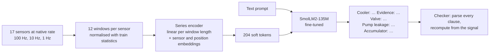

# The time-series language model

Sightglass's language model reads the 17 raw sensor series of one cycle and writes, token by token, the four-line diagnosis with its evidence. Nothing is computed for it: no physics feature, no label, no number. Every value it writes is its own reading of the series, and the [checker](../src/sightglass/eval/faithfulness.py) then recomputes each one from the signal, as it does for the engine. Its scores are in the [results table](../README.md#results), row *Sightglass TSLM*.

This is the comparison the project was built for: the engine's numbers verify by construction, a language model's do not.

## Architecture



| Part | What it is | Where |
|---|---|---|
| Windows | Each sensor cut into 12 equal windows at its own rate (500, 50 or 5 values). Each window keeps its values, normalised with the train-split mean and spread of that sensor, plus the window's own mean and spread | `cycle_patches` in [`src/sightglass/tslm/softprompt.py`](../src/sightglass/tslm/softprompt.py) |
| Series encoder | One linear projection per window length, a sensor embedding and a window-position embedding, then a small MLP into the language model's width | `SeriesEncoder` |
| Language model | [SmolLM2-135M](https://huggingface.co/HuggingFaceTB/SmolLM2-135M) (Apache-2.0), pinned to a commit in the config, fine-tuned in full | `SoftPromptTSLM` |
| Target | The train-split rationale of each cycle from `data/rationales/hydraulic.jsonl`: the true condition of each part and the evidence clauses with their true values | [`scripts/train_tslm.py`](../scripts/train_tslm.py) |
| Grading | `Engine.check_rationale`: reads the four labels from the text, parses every clause, and checks it with the engine's own extractor, healthy reference, tolerances and consistency checker | [`src/sightglass/engine.py`](../src/sightglass/engine.py) |

This follows OpenTSLM's soft-prompt design (series as learned embeddings in front of a text model), scaled down to a model that trains on a 4 GB laptop GPU. It is not OpenTSLM-Flamingo, which is still listed as not run.

## Rules it was trained under

- **Train split only** for the weights and the normalisation statistics.
- **Validation split** for every choice. Every epoch's checkpoint is kept; each is scored on the full validation split with the checker, and `select` keeps the one with the best mean of label macro-F1 and claim accuracy. This rule was written down before the test split was read (`results/tslm_selection.json` records every candidate). Decoding is greedy, so there is nothing else to tune.
- **One change made on validation evidence:** a first run, scored on validation cycles after one epoch, wrote the correct format and mostly verifiable numbers but called every valve "optimal". The run that produced the result weights the loss on each part's level name four times (`label_weight` in the config) and uses a lower learning rate for the language model. That first run is not reported.
- **Test split once**, at the end, with `make tslm-test`.
- **The tolerances were not touched.** `configs/faithfulness.yaml` is the same file the engine is graded with.
- **No numbers are fed in.** The prompt is the same fixed sentence for every cycle.

## What "verified" means for it

A claim such as `TS4 mean temperature 45.1 °C (8% above healthy)` is verified only if the recomputed TS4 mean is within the value tolerance of 45.1, and the recomputed deviation from the healthy reference is above healthy by about 8%. The model has to read a level, an average or a rise time off the series and write it to the right precision. A wrong number, a wrong direction, an unknown sensor or quantity, and a missing component line are all counted, never repaired.

Three measures are reported separately, as for the engine:

| Measure | Question |
|---|---|
| Labels (macro-F1, all four right) | Did it name the right condition? A line that names no known level counts as wrong |
| Claims verified | Are the numbers it wrote in the signal? |
| Consistency | Does the evidence it chose point to the label it gave? |

## Reproduce

```bash
uv pip install -r requirements-tslm.txt        # plus a CUDA torch build if you have a GPU
python scripts/train_tslm.py train             # about 3.5 hours on a GTX 1650; keeps epoch0.pt, epoch1.pt, ...
for n in 0 1 2; do python scripts/train_tslm.py evaluate --split val --checkpoint epoch$n.pt; done
python scripts/train_tslm.py select            # keeps the best on val as selected.pt
python scripts/train_tslm.py evaluate --split test
python scripts/evaluate.py && python scripts/export_site_data.py && python scripts/make_readme_table.py --write
```

The checkpoint (about 0.6 GB) is not committed. What is committed: `results/tslm_val.json`, `results/tslm_test.json`, the generated texts in `results/tslm_*_rationales.jsonl`, and a run folder under `results/runs/` with the config, environment and per-cycle predictions. The site re-checks the committed test texts when it exports, so the claims it marks are graded by the checker at export time, not copied.

Training on another GPU, or on CPU, will not give byte-identical weights: GPU kernels and mixed precision are not deterministic. The fresh-clone reproduction in [TESTING.md](../TESTING.md) re-checks the committed texts; it does not retrain this model.

## Limits

- **It learned to imitate the engine's explanations.** The targets were written by the rationale builder from the true labels, so the model learns which features to cite from those texts. What it cannot copy is the numbers, which differ in every cycle.
- **Small model, small data.** 135 million parameters and 1,543 training cycles from one rig.
- **One seed.** The engine's baselines report three seeds; this model was trained once.
