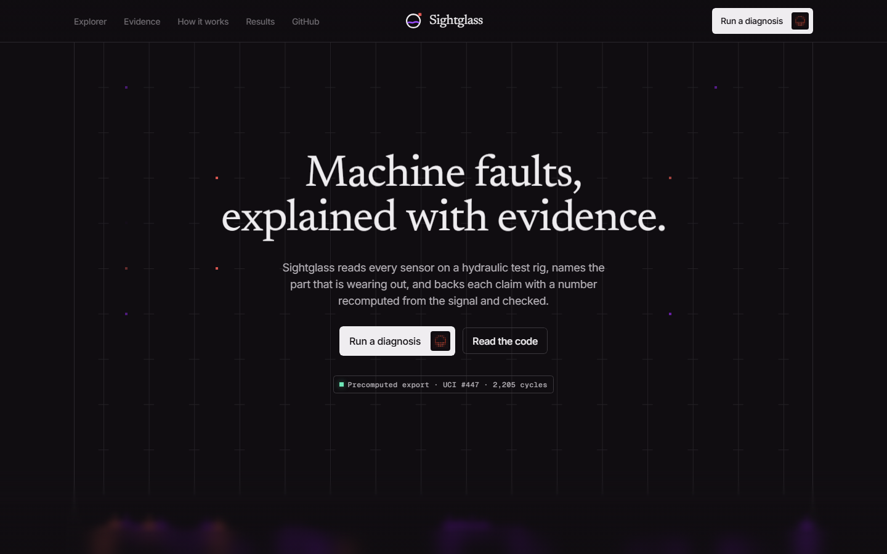
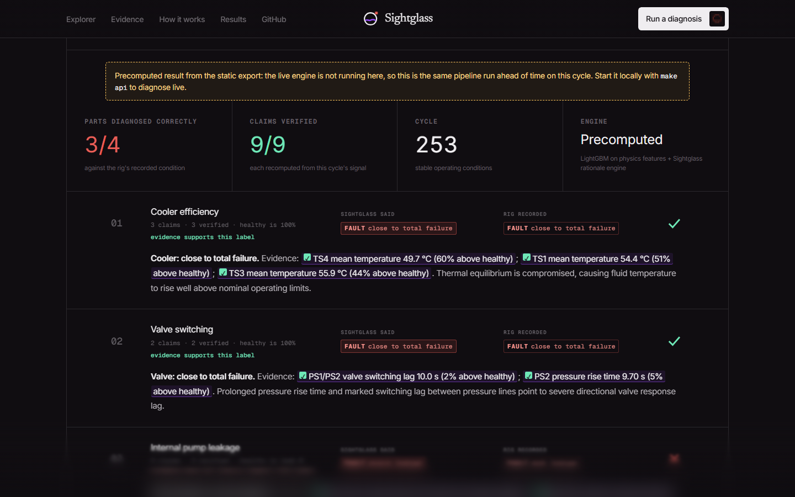
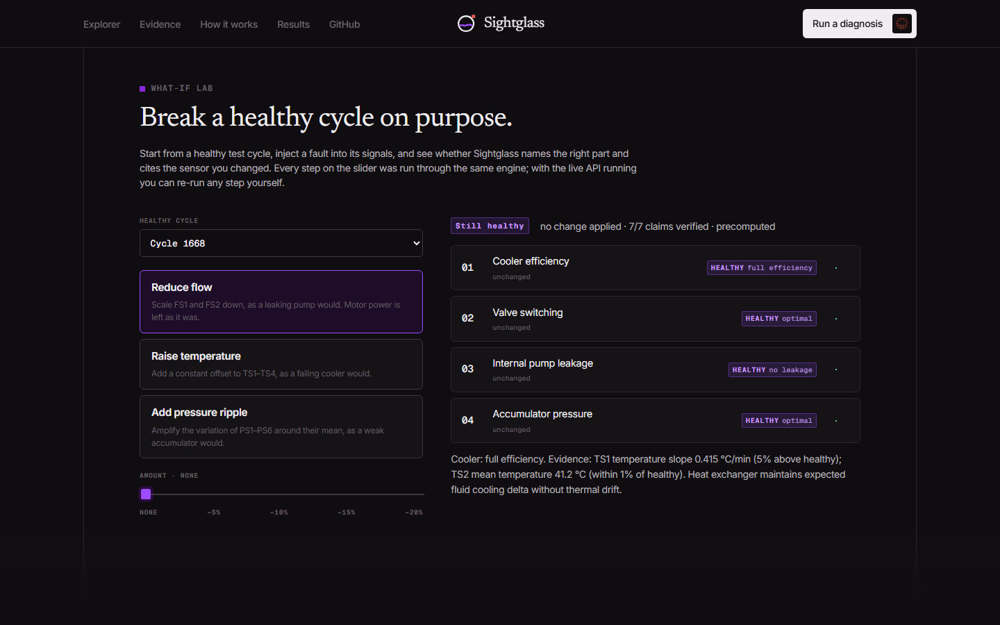
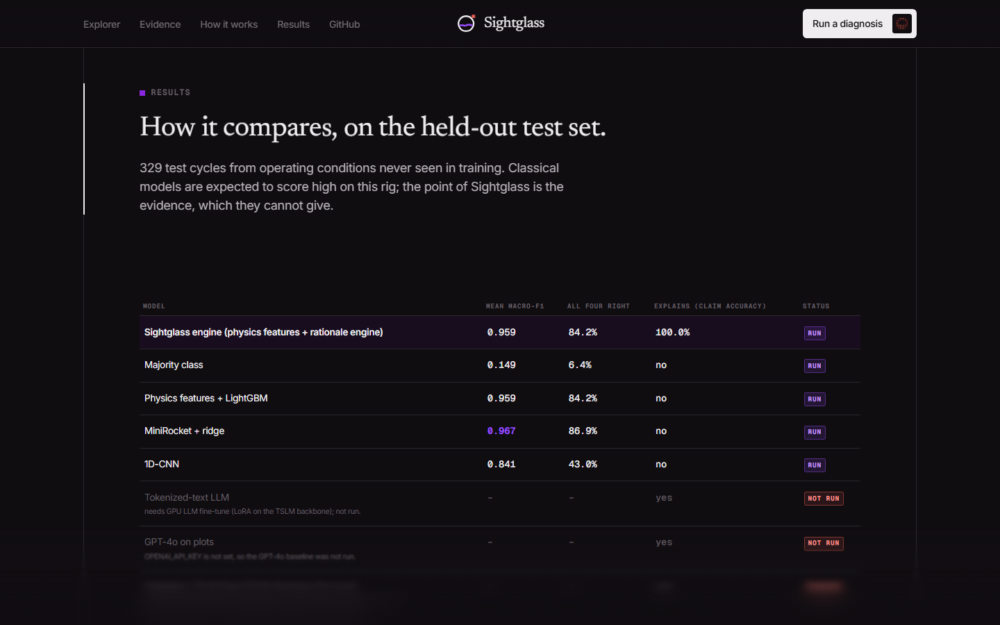

# The website

One long page, `web/src/App.tsx`, in React and TypeScript, built by Vite. **Every number on it is read from the JSON export in `web/public/data/`;** none is typed into the source, and `scripts/check_no_hardcoded_numbers.py` fails the build in CI if one is. It runs in two modes: **Precomputed**, from the export, which is all a static host can do, and **Live**, when the API answers on the same origin.

## What is on the page

In order, each a component under `web/src/sections/` or `web/src/console/`:

| Section | Anchor | What it shows | Data |
|---|---|---|---|
| Hero | `#top` | The claim, and a status line saying which mode the page is in | `manifest.json`, `/api/health` |
| What Sightglass watches, Impact, Intro | | The 17 sensors and the headline figures | `summary.json` |
| The evidence, Sensors | `#evidence` | The four parts, the sensors linked to each and the measured effect sizes | `hydraulic/links.json` |
| Explorer | `#explore` | Pick a test cycle, run it, read each component's verdict next to the recorded one, with every claim marked verified or not | `hydraulic/index.json`, `hydraulic/cycles/<id>.json`, or `/api/diagnose` |
| What-if lab | `#whatif` | One of six healthy test cycles, with flow cut, temperature raised or ripple added in steps, and how the verdict moves | `hydraulic/whatif/<id>.json`, or `/api/diagnose` |
| How it works, Proof | `#how`, `#proof` | The pipeline, and the checker's own tests | `summary.json` |
| Results | `#results` | Every baseline, including the ones not run, with the reason | `hydraulic/results.json` |
| Failure modes, Compare, Use for | | Where diagnostics mislead, and who this is for | `hydraulic/failures.json` |
| Console | `#ask` | Fixed questions about a cycle ("Which sensor deviates most?"), answered from the diagnosis. It is not a chat model | Same as the explorer |

## Screens

Captured from the production build served by `vite preview`, with no API running, at 1440 by 900:

| | |
|---|---|
|  |  |
| **The status line** says which mode the page is in before you do anything. | **A diagnosis that is partly wrong.** The pump label is wrong on this cycle, and the page shows it next to the recorded one. |
|  |  |
| **The what-if lab.** Each slider step is a precomputed run of the same engine on a perturbed signal. | **The results table** lists the baselines that were not run, with the reason, rather than leaving them out. |

To regenerate them:

```bash
cd web && npm run build && npx vite preview --port 4300 --strictPort   # leave running
node docs/screenshots/capture.mjs                                       # from the repo root, in a second terminal
```

`docs/screenshots/capture.mjs` drives a headless Chrome or Edge over the DevTools protocol, and the list is in `docs/screenshots/shots.json`. Chrome's own `--screenshot` flag was tried first, and captured the hero half-faded and the explorer blank, because the reveal animations never finish under its virtual clock.

## Modes and deep links

`web/src/lib/api.ts` decides the mode. It calls `/api` only on `localhost`, `127.0.0.1` or `[::1]`, or with `?api` in the URL, and it never mixes live answers with the mock export. The deep links (`?cycle=ID`, `&run`, `&ask`, `?mock`, `?api`) are listed in [`docs/deployment.md`](deployment.md#run-the-website-locally). A result always says where it came from: **Live** with the engine's time in milliseconds, or **Precomputed** with a note saying how to start the API.

## Design tokens

From `web/src/styles/tokens.css`. The page is dark only.

| Token | Value | Used for |
|---|---|---|
| `--bg` | `#100d11` | Page background |
| `--text` | `#efedf0` | Body text |
| `--violet-2` | `#9b4dff` | Accent, and verified (`--allow`) |
| `--coral` | `#ea5d56` | Faults and wrong claims (`--deny`) |
| `--mint` | `#6ee7b7` | Correct marks: ticks, the status dot, "evidence supports this label" |
| `--font-head` | Newsreader | Headings |
| `--font-body` | Inter | Body |
| `--font-mono` | Geist Mono | Numbers, labels, code |

Sizes are in `em` against a body size that scales with the window: 16 px at 1440 wide (`--size-font`). Below 992 px the layout switches to narrower padding, and there are further breakpoints at 768 and 480 px.

## Motion

`motion` animates the reveals and the explorer's run, and `lenis` smooths scrolling (`web/src/main.tsx`). Both respect the system setting: with reduced motion, `MotionConfig reducedMotion="user"` drops the transforms and Lenis is not started. Lenis is also off on touch-only devices. Scrollable panels such as the console's chat carry `data-lenis-prevent`.

## Tests

`web/src/test/rationale.test.tsx` checks that a rationale splits into one paragraph per component with the right offsets, that each claim renders as a chip with its verdict, and that the default cycle is a fully correct, fully verified one with the most faults. Run them with `npm test` in `web/`. Nothing tests the page in a browser automatically.
