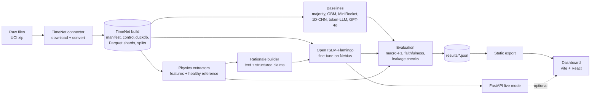

# Sightglass — Implementation Plan (TimeNet Hackathon)

Sightglass is a machine-health time-series language model (TSLM). It diagnoses industrial faults from raw sensor data and explains each diagnosis with numbers that can be checked against the signal. It ships with:

- a TimeNet dataset connector (merged PR),
- a fine-tuned OpenTSLM model,
- a full evaluation, including a faithfulness score for every explanation,
- a public dashboard that shows all of it.

**Who it helps.** Maintenance engineers in plants that can't afford a dedicated vibration or condition-monitoring analyst. They get a diagnosis and the evidence behind it, not a black-box label.

**Why the name.** A sightglass is the small window on a pump, gearbox or tank that lets you look inside the machine. Sightglass does the same for a model's diagnosis: you can see the evidence and check it.

---

## How to read this folder

Each phase is one file. Every file has the same sections: goal, owner and timing, inputs, tasks, interfaces (files, functions, schemas), tests, exit criteria, and risks.

| # | File | Phase | Owner | Round-1 days |
|---|---|---|---|---|
| 0 | [00-setup.md](00-setup.md) | Setup and verification | Both | 1 |
| 1 | [01-hydraulic-connector.md](01-hydraulic-connector.md) | Hydraulic dataset and TimeNet connector | Aman | 2–4 |
| 2 | [02-physics-rationales.md](02-physics-rationales.md) | Physics-grounded rationales | Aman | 3–7 |
| 3 | [03-baselines.md](03-baselines.md) | Baselines | Teammate | 5–8 |
| 4 | [04-finetuning.md](04-finetuning.md) | OpenTSLM fine-tuning on Nebius | Teammate | 7–10 |
| 5 | [05-evaluation.md](05-evaluation.md) | Evaluation and faithfulness | Aman | 6–11 |
| 6 | [06-inference-api.md](06-inference-api.md) | Static export and inference API | Teammate | 10–12 |
| 7 | [07-dashboard.md](07-dashboard.md) | Dashboard and showcase website | Teammate | 2–13 |
| 8 | [08-round2-bearings.md](08-round2-bearings.md) | Round 2: HUST bearings | Both | Round 2 |
| 9 | [09-round3-wind.md](09-round3-wind.md) | Round 3: CARE wind turbines | Both | Round 3 |
| 10 | [10-pooled-model.md](10-pooled-model.md) | Final round: pooled model | Both | Final |
| 11 | [11-submission-and-outreach.md](11-submission-and-outreach.md) | Submission, demo video, posts | Aman | 1, 7, 13–14 |

Cross-cutting material (principles, architecture, repo layout, conventions, timeline, budget, risks, definition of done) is in this file.

[BUILD_PROMPT.md](BUILD_PROMPT.md) is a ready-to-paste prompt for a coding agent to build the whole project from these files, milestone by milestone.

> **This is the original plan, kept for the record.** It describes what was intended, including a merged pull request, a trained TSLM, three machines and files that were never created. What exists is described in the [README](../README.md) and [ARCHITECTURE.md](../ARCHITECTURE.md). Lines in the phase files that name planned files carry a hidden `check-docs: ignore` comment for that reason.

> **Verify before coding.** TimeNet and OpenTSLM API names, paths and make targets in this plan come from research notes and may have changed. Check every one against the current docs and source before writing code that depends on it. Places that need this are marked **(verify)**.

---

## Guiding principles

1. **No result without a reproducible run.** Every number comes from a script, a config and a seed that anyone can rerun.
2. **Split by group, never by random window.** Group by cycle condition (hydraulic), recording or bearing (HUST), turbine or event (CARE).
3. **Always compare against simple baselines.** Lead with explanations and faithfulness, and report raw accuracy honestly, even where classical models win.
4. **Verify every external API** against current docs before coding.
5. **Each round's deliverable is complete and demoable on its own.** If time is short, cut scope inside a phase (fewer backbones, fewer ablations), never the PR, the evaluation or the demo.
6. **Every number on the dashboard comes from `results/`**, written by a script. Nothing is typed by hand.

---

## Roadmap across rounds

Each round adds one dataset, one result and one dashboard page. The final round adds a pooled model across all three.

| Round | Dataset (licence) | Signal type | Task | New dashboard page | Gate to move on |
|---|---|---|---|---|---|
| 1 | UCI hydraulic test rig (CC BY 4.0) | 17 multi-rate sensors (100 / 10 / 1 Hz) | Classify 4 component states + explain | Hydraulic diagnosis explorer | Connector PR merged; model beats tokenized-LLM baseline on macro-F1; faithfulness reported |
| 2 | HUST bearings (CC BY 4.0) | 51.2 kHz vibration | Classify 6 defect types, unseen-load test + explain via fault frequencies | Bearing explorer with envelope spectrum | PR merged; leave-one-load-out results reported |
| 3 | CARE wind turbines (CC BY-SA 4.0, check ShareAlike) | SCADA operational data | Early fault warning + explanation | Wind-farm view | PR merged; warning lead time reported |
| Final | All three, pooled | Mixed | One model, all tasks | Cross-machine comparison | Pooled vs single-dataset comparison published |

OPS-SAT spacecraft telemetry stays an optional extra if a round has spare time. Rounds run about two weeks each.

---

## System architecture

Data flows one way, from raw sensor files to the dashboard. Every stage writes files that the next stage reads, so any stage can be rerun alone.



The top path builds the dataset and the model. The bottom path checks them against baselines and publishes the results. The connector is shared: baselines and the TSLM read the same TimeNet build and the same split through one loader.

---

## Repositories

**1. Fork of `OpenTSLM/TimeNet`** — only what the connector PR needs. Confirm the path against the connector guide **(verify)**.

```
timenet_connectors/datasets/<org>/uci_hydraulic/
    __init__.py
    connector.py          # download() + convert()
    dataset.yaml          # dataset card: source, licence, signals, units, splits
    tests/test_connector.py
```

**2. Project repo `sightglass`** — everything else.

```
sightglass/
  README.md                     # results, how to reproduce, limitations
  pyproject.toml                # pinned deps; package name "sightglass"
  Makefile                      # make data / baselines / train / eval / export / site
  configs/
    data/hydraulic.yaml         # build path, split, downsampling, normalisation
    faithfulness.yaml           # tolerances, fixed before any results are seen
    baselines/hydraulic.yaml
    train/hydraulic_flamingo_gemma270m.yaml
    train/hydraulic_flamingo_llama1b.yaml
    train/ablations/*.yaml
  data/                         # gitignored: raw downloads + TimeNet builds
  src/sightglass/
    data/                       # TimeNet loading, Cycle objects, windowing, splits
    physics/                    # feature extractors per machine
      base.py                   # Feature, Extractor protocol, HealthyReference
      hydraulic.py
      bearing.py                # round 2
      wind.py                   # round 3
    rationales/                 # templates, builder, QA generation
    baselines/                  # majority, gbm, minirocket, cnn1d, token_llm, gpt4o_plots
    tslm/                       # OpenTSLM prompt building, training, inference wrappers
    eval/                       # metrics, faithfulness checker, consistency, ablations
    export/                     # writes dashboard JSON
    utils/                      # seeding, logging, config loading, run ids
  scripts/
    build_rationales.py
    run_baselines.py
    train.py
    evaluate.py
    export_site_data.py
  api/                          # FastAPI inference service + Dockerfile
  web/                          # dashboard (Vite + React + TypeScript)
  notebooks/                    # EDA only; nothing the results depend on
  results/                      # metrics JSON, confusion matrices, run logs (committed)
  tests/
```

---

## Conventions shared by every phase

**Identifiers**

| Thing | Format | Example |
|---|---|---|
| Dataset id | `<machine>` | `hydraulic`, `bearing`, `wind` |
| Cycle / window id | `<dataset>-<index>` (zero-padded) | `hydraulic-01423` |
| Feature name | `<SENSOR>.<quantity>` or `<SENSOR>_per_<SENSOR>` | `FS1.mean`, `EPS1_per_FS1` |
| Run id | `<dataset>_<model>_<variant>_s<seed>_<yyyymmdd>` | `hydraulic_flamingo-llama1b_full_s0_20261202` |

**Files**

- Configs are YAML, one per run, loaded through `sightglass.utils.config.load(path)`, and copied into the run folder at start.
- Every run writes `results/runs/<run_id>/` containing `config.yaml`, `metrics.json`, `predictions.jsonl`, `git_sha.txt`, `env.txt` (`pip freeze`).
- Summary files that the dashboard reads: `results/baselines.json`, `results/eval_<run_id>.json`, `results/faithfulness_<model>.json`, `results/ablations.json`.
- JSON numbers keep full precision. Rounding happens only in the UI.

**Seeds.** `sightglass.utils.seed.set_all(seed)` seeds Python, NumPy, PyTorch and CUDA. Main runs use seeds 0, 1 and 2.

**Code quality.** Ruff + mypy (strict on `src/sightglass/eval` and `physics`) + pytest in CI. Pre-commit runs ruff and a check that blocks files over 5 MB.

---

## Team split

The mechanical engineer owns data, physics and evaluation logic. The software and ML teammate owns training, the API and the website. Both review each other's work, and nothing merges to `main` without one review.

| Workstream | Owner | Support |
|---|---|---|
| TimeNet connector + PR | Aman | Teammate (review, CI) |
| Physics features + rationale templates | Aman | — |
| Faithfulness checker | Aman | Teammate (parsing) |
| Baselines | Teammate | Aman (features model) |
| OpenTSLM fine-tuning on Nebius | Teammate | Aman (configs, sanity checks) |
| Static export + inference API | Teammate | — |
| Dashboard | Teammate | Aman (content, failure analysis) |
| Demo video, posts, README, model card | Aman | Teammate |

A team of 3–4 gives the dashboard and the video and posts their own owners.

---

## Two-week round, day by day

| Day | Aman (data, physics, eval) | Teammate (ML, API, web) | Milestone |
|---|---|---|---|
| 1 | Phase 0: FAQ, PR and Discord search, fork checks | Phase 0: OpenTSLM smoke run on Nebius, repo, CI, tracker | Toolchain proven; "what we're building" post |
| 2 | EDA: label sequence, class counts, split decision | Agree export JSON schema; dashboard skeleton on mock data | Split decided; schema frozen |
| 3 | Connector `download()` + `convert()` | Shared loader in `sightglass.data`; majority baseline | Build loads locally |
| 4 | Connector tests, `dataset.yaml`, make checks, **open PR** | Features + LightGBM, MiniRocket | PR open |
| 5 | Feature extractors + healthy reference | 1D-CNN baseline | Classical baselines done |
| 6 | Feature-to-component links checked on train; templates | Prompt builder; Gemma-270M overfit smoke test | Pipeline wired |
| 7 | Rationales + QA for all cycles; 50-rationale spot check; checker self-test | Gemma-270M full run; mid-round progress post | Rationales frozen |
| 8 | Faithfulness parser + verifier | Tokenized-LLM baseline; GPT-4o plots baseline (200 cycles) | All baselines done |
| 9 | Consistency checker; leakage check setup | Llama-1B seed 0; Gemma ablations | Headline run started |
| 10 | Run checker on baselines | Llama-1B seeds 1, 2 | Training done |
| 11 | Full evaluation, ablations, seed variance, failure analysis | Static export script; API | `results/` complete |
| 12 | Failure gallery text, limitations text | Dashboard on real data; deploy | Site live |
| 13 | README, model card, demo video | Phone testing, polish, live API | Video recorded |
| 14 | Submit; results post | Buffer, fixes | **Submitted** |

The dashboard starts on day 2 against mock JSON in the agreed format, so it's ready when real results land around day 11–12.

---

## Compute budget (round 1)

A $500 Nebius voucher covers a full round on L40S GPUs with room to spare. H100s are needed only for a 3B model. Prices are a third-party read from 16 Nov 2026 (L40S from $1.55/hr, H100 $4.50/hr, preemptible from $0.79/hr). Check the Nebius console before booking.

| Item | GPU | Hours (est.) | Cost (USD) |
|---|---|---|---|
| Phase 0 smoke tests | L40S | 5 | 8 |
| 1D-CNN + tokenized-LLM baselines | L40S | 20 | 31 |
| Gemma-270M runs + ablations | L40S | 30 | 47 |
| Llama-1B main runs (3 seeds) | L40S | 60 | 93 |
| Export + evaluation inference | L40S | 10 | 16 |
| Live API hosting (on only during judging and demos) | L40S | 40 | 62 |
| Reserve for reruns and mistakes | — | — | 100 |
| **Total** | | **165** | **≈ 357** |

- Replace the hour estimates with real numbers after the Phase 0 timing run.
- Train on preemptible instances with a checkpoint every epoch, and resume automatically.
- GPT-4o baseline API calls are billed separately. A 200-cycle sample costs a few dollars.
- Apply for a new voucher each round. Prize credits from a win fund the pooled model.

---

## Risks and mitigations

| Risk | Likelihood | Impact | Mitigation | Phase |
|---|---|---|---|---|
| OpenTSLM won't train on our data or setup | Medium | High | Smoke test on day 1; fall back to Gemma-270M; ask in OpenTSLM issues and Discord | 0, 4 |
| Another team onboards the same dataset | Medium | High | Search PRs and announce in Discord on day 1; HUST or OPS-SAT as backup | 0 |
| Classical baselines beat the TSLM on accuracy | High | Medium | Expected; lead with faithfulness and explanations; report accuracy honestly | 3, 5 |
| Virtual sensors leak the cooler label | Medium | Medium | Ablation without CE / CP / SE; report both | 4, 5 |
| Model learns template phrasing, not evidence | Medium | High | Several templates per pattern; faithfulness check catches copied but wrong numbers | 2, 5 |
| Faithfulness parser misses claims | Medium | Medium | Canonical evidence clause in training targets; manual check of 100 outputs | 2, 5 |
| TimeNet PR not merged before judging | Medium | Medium | Open early, pass all checks, respond to review fast; submit the open PR link | 1 |
| Credits run out | Low | Medium | L40S not H100; auto-shutdown; preemptible training; reserve | 0, 4 |
| Live demo down during judging | Medium | High | Static precomputed site is the default; live API is optional | 6, 7 |
| CARE ShareAlike licence blocks TimeNet hosting | Medium | Medium | Ask early; fall back to a user-built connector or OPS-SAT | 9 |

---

## Definition of done — round 1

- [ ] Hydraulic connector PR passes all checks and is merged or under review.
- [ ] Every cycle has a physics-grounded rationale with structured evidence.
- [ ] Baselines and the fine-tuned Llama-1B model are evaluated on the same held-out split.
- [ ] Faithfulness is reported for Sightglass, the tokenized-LLM baseline and GPT-4o.
- [ ] Virtual-sensor and split-leakage ablations are reported.
- [ ] Dashboard is live with every page populated from `results/`.
- [ ] README, model card and limitations are written.
- [ ] Demo video recorded; X and LinkedIn posts published.
- [ ] Submission form filled with all links.

## Open questions to settle first

- [ ] What exactly does the FAQ say about submission contents and judging?
- [ ] Must the PR be merged, or only opened?
- [ ] Has anyone claimed the hydraulic, HUST or CARE datasets?
- [ ] Does the hydraulic data repeat label combinations through the run, or change in blocks? (Decides the split; see Phase 1.)
- [ ] Which OpenTSLM checkpoint is the best starting point for a new domain?
- [ ] How long are rounds 2 and 3, and do they change the rules?
